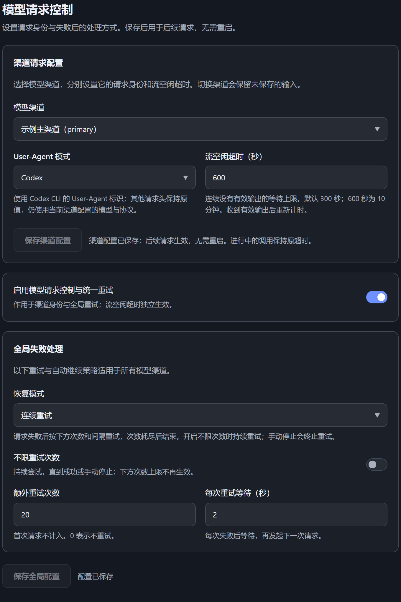
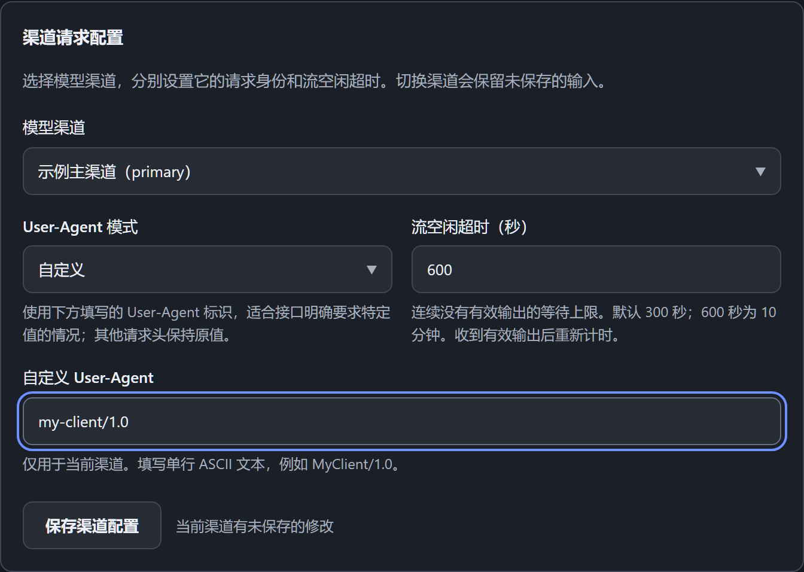
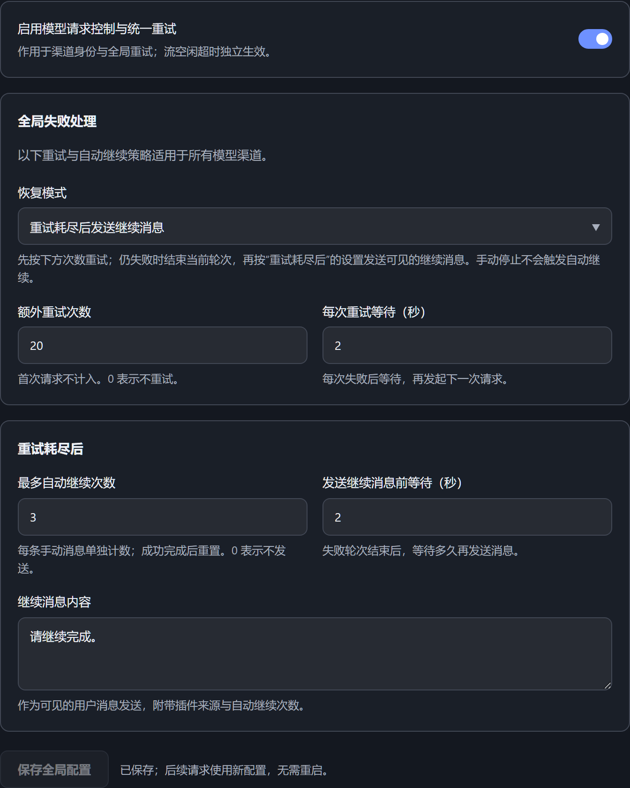

# 模型请求控制 · Model Request Controls

**请求用什么标识、失败后重试几次、每次等多久，由你设置。**

为 DeepSeek Harness 集中管理 **User-Agent 请求头、重试次数、重试间隔和流空闲超时**。不同渠道分别配置客户端标识与超时；请求失败后按你的策略重试，在会话中查看进度，也可以在重试耗尽后自动发送继续消息。

**[下载插件](https://github.com/Unended-night/dsh-model-controls/releases/download/v4.0.0/dsh-model-controls-4.0.0.tgz)** · [版本发布](https://github.com/Unended-night/dsh-model-controls/releases) · [使用说明](plugins/dsh-model-controls/README.md)



*实际插件设置组件的独立预览，使用示例渠道和演示数值。已在 Windows / Harness 0.2.1-rc.2 上验证。*

## 你可以控制什么

| 功能 | 可以做什么 |
| --- | --- |
| User-Agent 请求头 | 按渠道选择原生、Claude Code、Codex、pi，或填写自定义标识 |
| 重试次数与间隔 | 例如额外重试 20 次、每次等待 2 秒；会话内显示 `1/20`、`2/20` 等实际进度 |
| 不限次数重试 | 持续尝试，直到成功或手动停止 |
| 流空闲超时 | 例如从 300 秒调到 600 秒，容许模型更长时间没有有效输出 |
| 失败后自动继续 | 有限重试耗尽后发送继续消息，正文、等待时间和次数上限均可设置 |

User-Agent 可选 **原生（默认）、Claude Code、Codex、pi、自定义**。预设只改变 User-Agent 标识，模型、接口协议和认证仍使用你在 Harness 中的配置。

### 每个渠道，用自己的请求设置

一个渠道保留原生标识，另一个渠道使用自定义 User-Agent；需要长时间思考的模型，可以单独延长流空闲超时。选中渠道后保存，其他渠道保持各自的配置。



### 重试耗尽之后，也能安排下一步

选择“重试耗尽后发送继续消息”，填写继续指令，再设定等待时间与次数上限。自动消息会注明插件来源与当前次数；手动停止不会触发自动继续。



## 安装

已收录到社区插件市场：搜索 **`dsh-model-controls`**，认准作者 **Unended-night**。也可以通过固定版本链接安装：

1. 打开 Harness 的**插件管理**页面，进入安装入口。
2. 粘贴下面的安装链接，安装并启用插件。
3. 重启 Harness，打开 **设置 → 模型请求控制**。

```text
https://github.com/Unended-night/dsh-model-controls/releases/download/v4.0.0/dsh-model-controls-4.0.0.tgz
```

也可以先下载 `.tgz` 文件，再用文件的完整路径安装。请选择 Release 中的插件安装包；Source code ZIP 用于获取源码。

[查看更新与卸载说明](docs/INSTALLATION.md)

## 使用

### 按渠道配置

在上方的“渠道请求配置”中选择已有模型渠道，设置 **User-Agent** 和 **流空闲超时**，然后点击 **保存渠道配置**。每个渠道单独保存；切换渠道不会自动保存未提交的修改。

流空闲超时表示连续多久没有收到有效输出时结束等待。未调整过的渠道默认为 **300 秒**；例如改为 `600`，就允许模型连续 10 分钟没有有效输出。它控制的是输出间隔，不是整次请求的总时长。

### 配置失败处理

在下方选择恢复模式，设置参数后点击 **保存全局配置**。这些重试和自动继续设置对所有渠道生效。

- **连续重试**：默认额外重试 **5 次**，每次等待 **2 秒**。例如设为 20 次，消息页会显示 `1/20`、`2/20` 等进度。首次请求不计入重试次数。
- **不限重试次数**：持续尝试，直到成功或手动停止；开启后，次数上限暂不生效。
- **重试耗尽后发送继续消息**：先执行设定次数的重试；仍失败时，再发送你填写的继续消息，并受自动继续次数上限约束。

总开关控制 User-Agent 修改、重试与自动继续。流空闲超时独立生效。手动停止不会触发自动继续。

## 配置生效

**平时保存配置无需重启；首次安装或更新插件后重启一次。**

User-Agent 用于保存后的下一次请求，流空闲超时用于后续新模型调用。重试次数与间隔在下一次失败判定时读取；已经开始的等待不会重新计时。保存设置不会重新启动已经失败结束的任务。

## 使用范围

已在 Windows 的 DeepSeek Harness **0.2.1-rc.2** 上验证，覆盖 OpenAI Chat Completions、OpenAI Responses 和 Anthropic Messages。当前设置界面为中文；其他系统上的实际 Harness 使用尚未验证。

插件声明最低宿主版本为 `>=0.2.1-rc.2`。市场 **1.70.1** 对未关联 npm 包的 GitHub Release 插件会显示“宿主要求未知”：它尚未读取到版本要求，并非插件未声明，也不是不兼容结论。更高版本的实际兼容性仍需验证。

重试与自动继续可能增加请求量和费用，也无法解决无效密钥或额度不足。插件不发送遥测；反馈问题时请勿附带 API Key 或完整聊天内容。

[问题反馈](https://github.com/Unended-night/dsh-model-controls/issues) · [安全报告](SECURITY.md) · [贡献指南](CONTRIBUTING.md) · [MIT 许可证](LICENSE)
